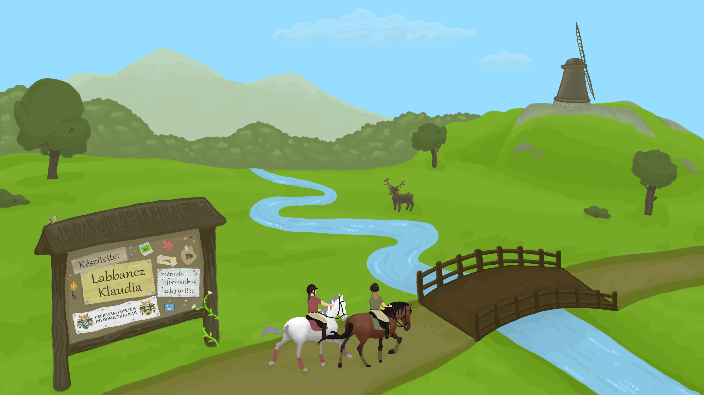

# Nemzeti parkok

**Ez a weboldal Labbancz Klaudia mérnökinformatikus Bsc hallgató szakdolgozata keretein belül készült a Debreceni Egyetemen 2026-ban.**

A weboldal fő célja a nemzeti parkok bemutatása, valamint népszerűsítése. Számtalan látnivalóról, rendezvényről és tanösvényről található információ az oldalon.
Továbbá a weboldalon helyet kapott még néhány játék is.

Az elkészült weboldal: **www.klaudialabb.github.io/Nemzeti-parkok/index.html**

## Funkciók
- nemzeti parkokba bepillantást nyerhetsz
- a leírások motiválnak egy kis kalandra a természetben
- a játékok kikapcsolódásra szolgálnak, valamint érdekességeket is olvashatnak a kiváncsiabbak

## Technológiák
- HTML5
- CSS3
- JavaScript

Ha a weboldallal kapcsolatos hibákat találsz, jelezd az alábbi email címen: **labb.klaudia@gmail.com**